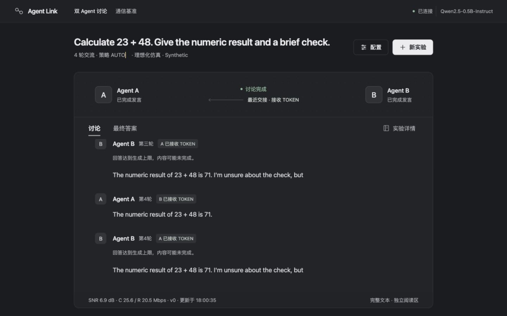
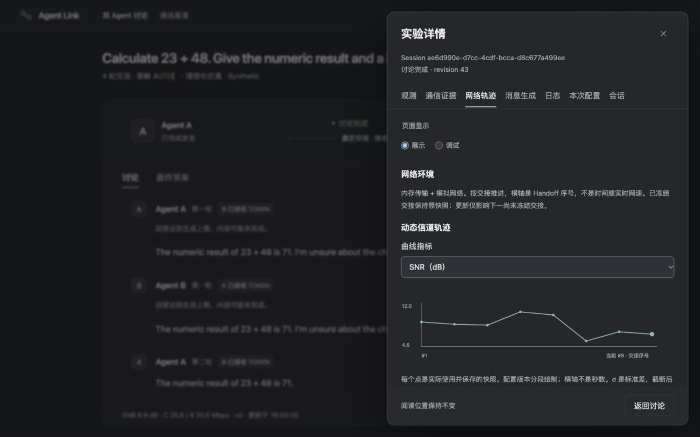
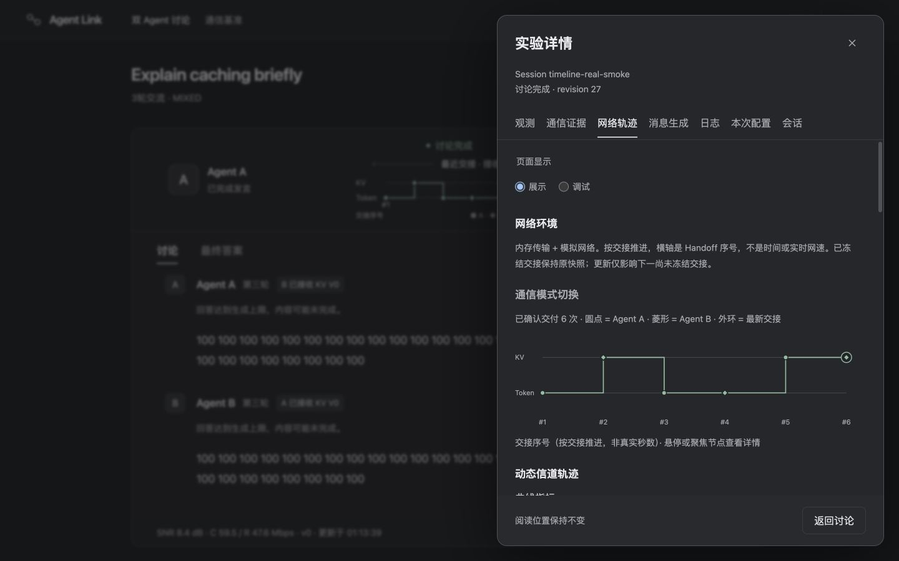
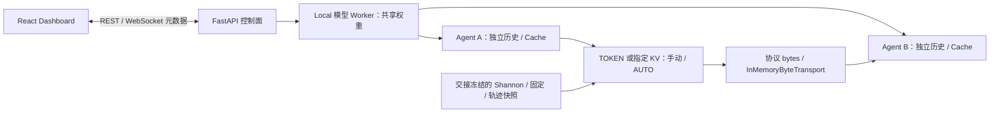
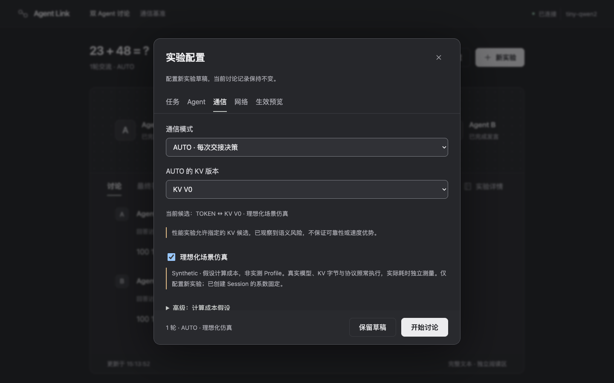

# Token/KV Agent System

双 Agent TOKEN / KV Cache 通信研究原型：在真实本地 LLM 推理与协议交接上，研究动态模拟信道中的通信选择、成本与语义边界。

> 这是从当前验收工作区筛选、脱敏的独立公开发布副本，不含原研发 Git 历史、原始实验数据或部署交接资料。见 [发布审查](docs/release/public-release.md)。
> 本项目尚未授予额外开源许可；没有新增项目级 LICENSE。公开可见不表示代码、研究资料或截图获授 MIT 等开源许可。第三方依赖和模型仍受各自许可约束。

## 背景与研究重点

两个 Agent 各自维护 System Prompt、消息历史与 KV Cache。TOKEN 路径传输 Token IDs，由接收方执行增量 Prefill；KV 路径传输发送方生成过程中的消息 KV，接收方进行兼容检查、恢复和可选修正，再继续 Decode。

当前正式方向是 **Mac Local 真实推理 + Shannon 容量与动态 SNR 软件模拟**。AUTO 在 TOKEN 与用户指定的一个 KV 版本之间选择，只执行选中的正式路径。我们关注：什么时候计算节省能抵消更大的 KV 包、成本预测在什么域内有效，以及工程交付成功是否伴随信息理解正确。

这里没有物理无线通信实验，也没有证明 KV 普遍快于 TOKEN。历史分布式 Worker / Socket / Relay 原型保留供研究追溯，当前主界面使用 Local。

## 核心功能

- 双 Agent 多轮讨论、独立上下文、持久会话内 Cache、逐次交接与最终回答。
- 手动 TOKEN、KV V0–V3、Mixed 计划，以及质量优先 / 性能实验 AUTO。
- 固定速率、速率轨迹、Shannon + AR(1) SNR；交接时冻结网络快照，支持运行中网络 PATCH。
- 实际执行模式时间线、SNR / 容量 / 模拟速率曲线、协议字节、成本来源、失败和终止原因。
- Measured Profile 身份与适用域校验、显式 Synthetic 假设、预测误差与临界条件分析。
- REST / WebSocket 控制面、离线测试、冻结实验配置、原始输出与负面研究证据。

## Dashboard

以下图片来自仓库已有验收记录，未重新生成或修改实验内容。[截图来源与适用范围](docs/assets/dashboard/README.md)。



真实 Qwen2.5-0.5B / MPS 的四轮讨论；AUTO 使用 **Synthetic 预测**。回答中的不确定与预算截断原样保留，此图不代表质量或加速证明。

| 动态 SNR 模拟轨迹 | 已确认交接的模式时间线 |
| --- | --- |
|  |  |

右图来自 random/tiny-Qwen2 CPU 的真实协议工程验收，使用测试 Tokenizer 与受控输出 ID，不能作为预训练模型性能或语义质量证据。

## 系统数据流



上图展示 A→B，反向流程相同。Dashboard 不转发 Tensor 或模型通信包。网络模型计算模拟成本，默认不 sleep、不限制内存传输的实际吞吐；`observed_local_ms` 是本地实测耗时。[当前架构说明](docs/current-architecture.md)。

## 环境要求

| 项目 | 要求与验证范围 |
| --- | --- |
| Python | 项目声明 `>=3.10`；本轮完整安装与测试使用 **3.14.6 / macOS arm64**。其他 Python 版本未逐一验证 |
| Node.js | 前端锁文件与测试工具要求 **20.19.x+（20 系列）、22.12.x+（22 系列）或 >=24**；本轮使用 **26.0.0 / npm 11.12.1** |
| 正式讨论 Dashboard | Apple Silicon Mac、可用 MPS；该入口强制 MPS、离线模型 Worker，无 CPU 回退 |
| 模型 | 默认 Qwen2.5-0.5B-Instruct；0.5B / 1.5B / 3B 菜单仅加载本地完整缓存。内存保护可能拒绝加载或长讨论 |
| 无模型演示 | 基础依赖即可运行 Mock 通信基准；不代表真实 LLM |

Python 精确版本参考见 [本轮验证依赖快照](requirements/tested-macos-py314.txt)，它是 macOS/Python 3.14 的 constraints，非跨平台锁文件。

## Quick Start

所有命令从仓库根目录开始。正式讨论需要 **两个终端**；先安装依赖与准备模型，再分别保持后端、前端运行。

### 1. 一次性安装

```bash
python3 -m venv .venv
source .venv/bin/activate
# 本轮验证环境：macOS arm64 / Python 3.14
python -m pip install -c requirements/tested-macos-py314.txt -e '.[dev,llm]'
cd frontend
npm ci
cd ..
```

其他 Python / 平台可按声明范围安装 `python -m pip install -e '.[dev,llm]'`，但需独立验收，不能直接套用上述平台快照。已有虚拟环境应先核对版本，不要覆盖自己的环境。

### 2. 准备模型（联网一次，随后离线）

```bash
python -c "from huggingface_hub import snapshot_download; snapshot_download('Qwen/Qwen2.5-0.5B-Instruct', revision='7ae557604adf67be50417f59c2c2f167def9a775')"
```

权重位于 Hugging Face 用户缓存，**不放入 Git**。默认模型名通过缓存 `refs/main` 解析；若缓存指向其他 revision 或有多个快照，请按 [安装指南](docs/getting-started.md) 显式传入下载返回的目录。Dashboard 本身不下载模型；没有完整缓存会启动失败。1.5B / 3B 需要另行准备对应权重，0.5B Profile 不可复用为它们的性能证据。

### 3. 终端一：后端

```bash
source .venv/bin/activate
python run_dashboard.py --discussion --device mps
```

默认监听 `http://127.0.0.1:8000`，启动时先加载模型。健康检查：`curl http://127.0.0.1:8000/api/health`；API 文档：`http://127.0.0.1:8000/docs`。

### 4. 终端二：前端

```bash
cd frontend
npm run dev
```

浏览器打开 **http://127.0.0.1:5173**，在“双 Agent 讨论”配置并启动实验。Vite 将 `/api`、`/ws` 代理到后端 8000。结束后，分别在两个终端按 **Ctrl+C** 正常停止服务；不要直接终止其他已有进程。

无 MPS 或暂不准备权重时，可将后端命令替换为 `python run_dashboard.py --interactive`，前端切到“通信基准”查看 **Mock** 演示。此模式不提供真实模型讨论。

完整的模型路径、端口冲突、503 / 409 / 422、离线缓存和停止说明见 [安装与启动](docs/getting-started.md)。本轮实测范围与未验证步骤见 验收记录（原研发资料，未随公开副本提供：`docs/release/validation.md`）。

## 实验配置

| 设置 | 含义与边界 |
| --- | --- |
| TOKEN | 接收原始 IDs 并对新消息增量 Prefill；既有接收方历史保持 |
| KV V0 | `raw_delta`：直接追加发送方 Decode 消息 KV，不消除历史语义差异 |
| KV V1 | `rope_aligned_delta`：修正 K 的 RoPE 位置，不能修复所有上下文差异 |
| KV V2 | `suffix_recompute_delta`：在 V1 基础上真实重算连续尾段；默认 k=1，可设数量/比例，wire 不因此缩小 |
| KV V3 | `numeric_slot_delta`：有界数字 Token 槽位修正；没有合法槽位时明确拒绝，无静默 TOKEN fallback |
| AUTO 质量优先 | 默认以 TOKEN 保护；未经认证的 KV 不因预测便宜而放行，不等于 TOKEN 已获通用语义认证 |
| AUTO 性能实验 | 显式允许实验路径；比较 TOKEN 与一个指定 KV，V3 还需额外许可 |
| Measured Profile | 模型/revision、设备、dtype、实现、工作负载及域检查有效时才预测；域外/缺校准不填虚构成本 |
| Synthetic | 理想化假设；后端/CLI 默认关闭，最新 UI 新草稿默认开启；可改变预测与选择，实际推理/协议仍执行，不是 measured 性能结论 |
| Shannon | `C=B log2(1+SNR)`、`R=ηC`；B 用 MHz、SNR 用 dB、C/R 用 Mbps，η 为假设 |

最新 UI 新草稿默认 AUTO / performance_experiment / KV V0 / Synthetic 开启；历史 Session 配置保持原值。[最新配置界面](docs/auto-config-defaults/README.md)。



普通讨论新草稿默认四轮，常规 1–10 轮，高级最多 20 轮；上下文、单次生成预算与内存保护可能提前拒绝或停止。最近三份 Session 元数据只在服务生命周期内保留；刷新可恢复，重启不承诺历史或 Cache 恢复。

## 实验复现与结果

从 [复现指南](docs/reproducibility.md) 开始：先运行测试，再复现短 TOKEN 基线，最后按冻结方法比较 KV 或 AUTO。保留模型 revision、软件/设备身份、Prompt、Token 预算、seed、策略、成本来源与完整输出；相同 seed 只保证相同条件下的信道采样，不保证模型数值或性能完全一致。

- [Shannon 动态信道](docs/shannon-dynamic-channel-simulator.md)：真实 0.5B 推理上的软件信道与 Synthetic 切换证据。
- [泛化 AUTO 成本模型](docs/generalized-auto-cost-model.md)：有界 Measured 校准/holdout，已有实测域未得到普遍 KV 性能优势。
- [性能拆解](docs/token-kv-performance-characterization.md)、[系统质量验收](docs/token-kv-system-quality-validation.md)：工程交付、语义与成本分别评价，保留失败及不确定结果。

`docs/` 仅包含筛选的技术说明、截图和一个已脱敏的回归测试 Profile。原始数据、冻结源码快照、完整历史证据、服务器记录与用户导出均不公开。`experiments/` 仅保留两个自包含的报告辅助程序供测试使用。历史报告中的数值是既有研究记录，本副本不提供其完整 raw 重放；已脱敏 Profile 不可用作本机合法性能校准。

## 文档与目录导航

- [文档总索引](docs/README.md)：使用指南、架构/协议、Shannon/AUTO、筛选的研究说明。
- [脚本说明](scripts/README.md)：启动入口、研究工具与兼容包装。
- [UI 设计规范](DESIGN.md)、[最新配置截图](docs/auto-config-defaults/README.md)。

```text
src/token_kv_agent_system/   # 运行时、模型、协议、网络、选择器及 Dashboard 后端
frontend/                   # React / TypeScript / Vite
scripts/                    # 分析、导出、历史诊断工具实现与完整清单
run_dashboard.py            # 正式 Dashboard 入口
run_demo.py                 # 无模型 CLI 示例
run_*.py / export_*.py      # 已引用研究入口、薄包装或兼容入口
requirements/               # 已验证环境的依赖约束快照
experiments/                # 两个经过审查的报告辅助程序
docs/                       # 当前指南、历史研究、小型证据及展示截图
tests/                      # Python 工程验证
```

## 当前限制与研究边界

KV 的数值兼容和协议接收成功不等于语义等价；现有小模型仍会复述、混淆信息、生成错误答案或预算截断。质量结论只限冻结测试范围。Canonical clean-Prefill 基准与讨论的增量消息 KV 是不同实验路径，不能混用 Profile 或成本边界。

当前主路径没有物理无线链路、硬件吞吐或一般性 KV 加速证明。历史独立进程 / Relay 仅有已记录的软件验收，服务器 CUDA、双 GPU、真实无线现场不属于本轮验证。项目没有通用暂停/取消、生产认证、持久 Cache 恢复或逐 Token 流式 UI；不应作为已认证的生产通信系统部署。

项目许可证仍待维护者决定；本次不添加新的 LICENSE。见 [第三方与素材说明](THIRD_PARTY_NOTICES.md) 和 [发布审查](docs/release/public-release.md)。
